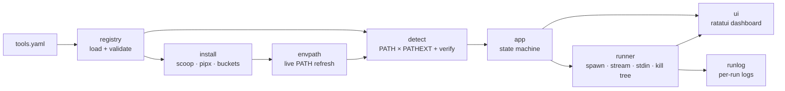

<div align="center">

<a href="https://tahabenissa.github.io/nasrya-toolbox/">
  
</a>

### The native-Windows security toolbox, in your terminal.

**Find, install and run 45 curated pentest & CTF tools from one keyboard-driven dashboard.**<br>
No WSL. No VM. No guesswork about what actually works on Windows.

<br>

<a href="https://tahabenissa.github.io/nasrya-toolbox/"></a>&nbsp;
<a href="https://tahabenissa.github.io/nasrya-toolbox/docs/"></a>&nbsp;
<a href="https://tahabenissa.github.io/nasrya-toolbox/demo/"></a>

<br>

[](https://github.com/tahabenissa/nasrya-toolbox/actions/workflows/ci.yml)
[](https://github.com/tahabenissa/nasrya-toolbox/releases)


[](LICENSE)

[Quick start](#quick-start) •
[Features](#features) •
[Catalog](#the-catalog) •
[Usage](#usage) •
[Adding tools](#adding-a-tool) •
[Security model](#security-model) •
[Architecture](#architecture) •
[Roadmap](#roadmap)

</div>

---

> [!WARNING]
> **Authorized use only.** Winsploit is for authorized penetration testing, security research,
> CTFs and learning. Only point it at systems you own or have **explicit written permission** to
> test. Unauthorized scanning or attacking is illegal in most jurisdictions, and staying inside
> your rules of engagement is your responsibility.

---

## Why Winsploit?

Kali is the home of security tooling, but plenty of people work on **Windows**, and the existing
options all make you compromise:

| Option | What's good | What's missing |
|---|---|---|
| **Commando VM / FLARE-VM** | Excellent, thorough | One-shot *VM provisioners*, not something you open every day |
| **PentestBox** | Right idea: native and portable | Abandoned since ~2016, unclear licensing |
| **UniGetUI** | Great package GUI | No security curation, no "run the tool" workflow |
| **Winsploit** | Curated, native, installs **and** runs, MIT, actively developed | Alpha, see [Roadmap](#roadmap) |

There is no actively maintained, cleanly licensed, native-Windows launcher that both *installs*
and *runs* security tools from one interface. Winsploit fills that gap, and it's honest about what
really works on Windows and what needs Linux.

## Quick start

**You need:** Windows 10/11, [Scoop](https://scoop.sh) (Winsploit installs tools through it), and
[Rust 1.87+](https://rustup.rs) to build from source.

```powershell
# 1. Install Scoop (skip if you have it)
Set-ExecutionPolicy -ExecutionPolicy RemoteSigned -Scope CurrentUser
Invoke-RestMethod -Uri https://get.scoop.sh | Invoke-Expression

# 2. Build winsploit
git clone https://github.com/tahabenissa/nasrya-toolbox
cd nasrya-toolbox
cargo build --release

# 3. Launch the dashboard (a dev build finds the checkout's tools.yaml from any directory)
.\target\release\winsploit
```

Pick a tool with `↑/↓` (or `/` to filter), press `i` to install it and `Enter` to run it. Press
`?` any time to see every key.

> [!NOTE]
> **Prebuilt binaries:** tagging `v*` publishes a Windows x64 zip (`winsploit.exe` + `tools.yaml`) on
> the [Releases](https://github.com/tahabenissa/nasrya-toolbox/releases) page. The current
> `v0.1.0` release **predates** everything listed under [What's new](#whats-new), so build from
> source for now. The binary is unsigned, so Smart App Control may ask you to allow it.

## Features

### A dashboard built for the keyboard
- **Browse by category** with live install status: `●` installed, `○` missing, `◐` conflict.
- **Instant filter (`/`)** by name, category or description. Words AND together.
- **A real line editor** for arguments: word jumps, word delete, paste, and per-tool **history**
  with `↑/↓`.
- **Key help overlay (`?`)** so the footer stays short.

### Live, interactive output
- stdout/stderr **stream into the output pane** in real time, color-coded.
- **Talk to running tools.** Each process gets its own input pipe, so you can answer prompts
  (`Ctrl+D` = end of input) without fighting the dashboard for keystrokes.
- **Scrollback** (`PgUp/PgDn/Home/End`) and **find in output** (`f`, `n`, `N`) with highlighting.
- **Survives messy output:** non-UTF-8 bytes don't stop the stream, and carriage-return progress
  bars and ANSI escape codes are cleaned up instead of smearing the pane.
- **`c` cancels** the whole process tree, not just the parent.

### One-key installs, done properly
- **Scoop** for native tools, with **missing buckets added automatically** the first time
  they're needed (`bucket/pkg` is pinned so the right package wins).
- **pipx** for Python tools. Each gets its own venv, and Winsploit installs Python and pipx
  through Scoop first if they're missing.
- **Winsploit's own Scoop bucket** for tools nobody else packages (gau, John jumbo, steghide, nikto,
  SecLists-lite). Each has a pinned URL and **SHA-256 hash**.
- **PATH changes picked up live** after an install, with no restart needed.
- Detection runs **in-process and off the UI thread**, so the dashboard never freezes.

### Built for CTFs
- **Challenge workspaces** (`C`). One folder per challenge under `%USERPROFILE%\ctf\<event>\<challenge>`
  with its target, flag format, files, notes, run logs and flags. The header shows what you're on.
- **Recipes**. Enter on nmap, ffuf, john, upx, volatility3 and a dozen more offers ready-made
  commands (`quick`, `full`, `udp`, `unpack`…) with the challenge's `{target}`, `{file}`, `{out}`
  folder and `{wordlist}` filled in. Anything missing is asked for once and remembered.
- **Flag catcher**. `picoCTF{…}`, `HTB{…}`, `flag{…}` and the event's own format are highlighted
  in any output, announced, copied to the clipboard, saved to `flags.txt` and listed under `F`.

### Built-in helpers
- **Hash identifier** (`h` in the dashboard, or `winsploit hashid <hash>`). Works offline, knows
  45 hash formats, and gives the matching **`hashcat -m`** mode and **`john --format`** name.
- **Per-run log files** for every run and install: the command, all output (including what you
  typed), the exit code and timestamps. Ready to use as evidence in a report.

### The same session in your browser
The terminal stays the main app, and the browser is a second window onto the **same live
session**, the way Claude Code works.
- At start-up, choose **Continue in terminal** or **Open in browser** (`--web` / `--no-web` skip
  the question). In the dashboard, `w` starts or stops the web view and `o` opens it.
- Run, install, stop, type into a tool, close terminals and identify hashes from either side.
  Output streams to both, and every run log records where it was started from.
- The browser adds a **grid** of all four terminals, **log downloads**, **toasts** and optional
  **desktop notifications** when a long scan finishes.
- **On your network:** `--lan` (or `W` in the dashboard) serves your LAN too, **over HTTPS**.
  The terminal prints the address, the certificate fingerprint and a **one-time join key**. A
  guest opens the address, accepts the self-signed certificate once per device, types the key and
  waits. You choose **Watch only**, **Full control** or **Deny** in the terminal or in your own
  browser tab. `L` shows the key and every guest, makes a new key, switches roles and removes
  people. Runs a guest starts are labelled with their name and IP in the output and the run log.

### Config-driven, honest by design
- Every tool is a **YAML entry**, so you add one without touching code.
- **Four launch modes:** `stream` (CLI in the pane), `gui` (desktop apps), `web` (start a server,
  open the browser) and `dataset` (wordlists).
- **Impostor detection:** `verify:` catches same-named programs (ProjectDiscovery `httpx` vs the
  Python `httpx`, Sysinternals `strings` vs GNU `strings`) and refuses to launch the wrong one.
- **Per-tool caveats** (`note:`) are shown on every run, for example "needs Npcap + admin".

## The catalog

**45 tools across 11 categories**, all chosen because they run well **natively** on Windows.

| Category | Tools |
|---|---|
| **Recon** | nmap · rustscan · gobuster · httpx · subfinder · amass · gau |
| **Web** | sqlmap · nuclei · ffuf · feroxbuster · katana · arjun · dirsearch · wfuzz · commix · nikto · ZAP (GUI) |
| **Passwords** | hashcat · John the Ripper (jumbo) · hashid · NetExec |
| **Crypto** | openssl · RsaCtfTool · CyberChef (browser) |
| **Forensics** | exiftool · strings (Sysinternals) · Sleuth Kit · Volatility 3 |
| **Reversing** | radare2 · upx · jadx · apktool · Detect It Easy · Cutter (GUI) · x64dbg (GUI) · dnSpy (GUI) · Ghidra (GUI) |
| **Pwn** | pwntools · ropper |
| **OSINT** | theHarvester · Sherlock |
| **Stego** | steghide |
| **Sniffing** | tshark |
| **Wordlists** | SecLists-lite (dataset) (wired into gobuster, ffuf, feroxbuster, dirsearch, wfuzz and john) |

<sub>(GUI) desktop app (`launch: gui`) · (browser) opens in your browser (`launch: web`) · (dataset) data, nothing to run (`launch: dataset`)</sub>

### Honest scope

| Works great | Works, with notes | Use Linux instead |
|---|---|---|
| nmap, nuclei, ffuf, gobuster, httpx, subfinder, katana, radare2, Ghidra | **hashcat** needs GPU drivers · **tshark** needs Npcap and admin · Python tools need pipx (Winsploit bootstraps it) | **Live Wi-Fi capture** (aircrack-ng: no monitor mode or injection) · THC-Hydra, WPScan, WhatWeb, masscan (degraded on Windows) |

> [!IMPORTANT]
> **Wireless, honestly:** live Wi-Fi monitor mode and packet injection **don't work** on Windows
> with normal adapters. Only *offline* cracking of files you've already captured is useful here.
> For real wireless work, use Linux with a supported USB adapter. That's why aircrack-ng is
> deliberately left out of the catalog.

## Usage

```text
winsploit                 launch the interactive dashboard
winsploit list            list the catalog with install status (installed / missing / CONFLICT)
winsploit hashid <h>…     identify one or more hashes (hashcat -m / john --format hints)
winsploit --help, -h      show help
winsploit --version, -V   show version

--catalog <path>          use a specific tools.yaml (works with or without `list`)
--web / --no-web          open the web view too / terminal only (skips the start-up question)
--lan                     serve the web view to your local network too (HTTPS, join key + your OK)
--port <n>                web view port (default 7878, else a free one)
```

### Dashboard keys

| Key | Action |
|---|---|
| `↑` `↓` | Move selection |
| `/` | Filter by name, category or description (`Esc` clears) |
| `Enter` | Run the selected tool (edit the prefilled args, then `Enter`) |
| *while running* | Type a line to send to the tool's input · `Ctrl+D` = end of input |
| `i` | Install the selected tool (Scoop or pipx) |
| `r` | Re-detect what's installed |
| `PgUp` `PgDn` | Scroll the output · `Home` = top · `End` = follow live output |
| `f` · `n` · `N` | Find in output · older match · newer match |
| `c` | Cancel the running process (kills the whole tree) |
| `h` | Identify a hash (built in, offline) |
| `C` | Challenges: create, switch, set the target / flag format, add files, open notes |
| `F` | Flags caught in tool output (`Enter` copies one) |
| `S` | Run the selected tool in Windows Sandbox (see below) · `Tab` in the prompt = network on/off |
| `t` | Appearance: theme, borders, glyphs, overlays (live preview) |
| `w` · `W` · `o` | Web view: start / stop · serve your LAN · open it in the browser |
| `L` | LAN guests: join key and who's in · `v` / `f` watch / full control · `x` remove · `n` new key |
| `?` | Show all keys |
| `q` | Quit |

### Appearance

Press `t` for the appearance panel. Changes preview live across the whole
dashboard; `Enter` saves them to `%APPDATA%\winsploit\settings.yaml`, `Esc`
puts the old look back.

| Setting | Options |
|---|---|
| Theme | The same set as Claude Code's `/theme`: dark, light, colour-blind-friendly dark / light, ANSI-only dark / light. Plus *Winsploit classic* (the original cyan). `1`–`7` pick one directly. |
| Borders | rounded `╭─╮` · plain `┌─┐` · double `╔═╗` · thick `┏━┓` · ascii `+-+` |
| Glyphs | unicode `● ○ ◐ ⠋ ▸` · ascii `* o ~ \| >` (for console fonts without those characters) |
| Bold text | on · off |
| Overlays | docked full-width above the footer (Claude Code style) · centered |
| Backdrop | dim the dashboard behind an overlay · leave it as is |

The terminal picks the typeface itself; these settings choose which characters
Winsploit draws and how heavy they are. If you see boxes or `?` in the
Windows console, set borders and glyphs to *ascii*. The file can also be edited
by hand; missing keys keep their defaults:

```yaml
theme: dark            # light, dark-daltonized, light-daltonized, dark-ansi, light-ansi, cyan
borders: rounded       # plain, double, thick, ascii
glyphs: unicode        # ascii
bold: true
overlay: docked        # centered
backdrop: dim          # none
```

### Editing arguments

The args and hash prompts are real line editors:

| Keys | Action |
|---|---|
| `←` `→` · `Ctrl+←` `Ctrl+→` | Move by character · by word |
| `Home` `End` (or `Ctrl+A` `Ctrl+E`) | Start / end of line |
| `Del` · `Ctrl+Backspace` / `Ctrl+W` · `Ctrl+U` | Delete char · delete word · clear to start |
| `↑` `↓` | Cycle through args you've used with this tool (per session) |
| Paste | Whole command lines work |

**Quoting:** arguments split on spaces, and `"double"` or `'single'` quotes keep spaces together:

```text
-H "User-Agent: winsploit"     -w "C:\My Lists\big.txt"
```

Backslashes are literal (no need to double them) and `\"` is a literal quote. A quoted path can't
end in a backslash, so write `"C:\dir"`, not `"C:\dir\"`.

### Challenges, recipes and flags

Press **`C`**, then **`n`**: give the event and challenge a name, the target (IP, host, URL or
`nc host port`) and, if the event uses its own format, the flag prefix (`ACME{`). Winsploit makes

```text
%USERPROFILE%\ctf\picoCTF-2026\rev-crackme1\
    challenge.yaml   files\   logs\   out\   flags.txt   notes.md
```

and, while it's active, every run log, flag and recipe output goes there. In the `C` picker,
`Enter` switches, `t` / `l` change the target / flag format, `f` copies a file in (the original
is left alone), `m` opens the notes, `o` the folder and `x` leaves the challenge. The web view
shows the active challenge and can switch between existing ones.

**Recipes.** `Enter` on a tool with recipes shows them already filled in; pick one, check the
arguments, `Enter` runs it. Placeholders in `tools.yaml` (write them unquoted):

| Placeholder | Becomes |
|---|---|
| `{target}` | the challenge's target (asked for once, then saved in the challenge) |
| `{file}` | the challenge file (asked for when there are several; files from elsewhere are copied in) |
| `{out}` | the challenge's `out\` folder, for files tools write (`nmap -oN`, `upx -o`…) |
| `{wordlist}` | SecLists-lite `common.txt`, or the challenge's own wordlist |

Each value becomes exactly one argument, so a path with spaces stays whole and a target can never
smuggle in extra flags.

**Flags.** Known prefixes (`flag`, `CTF`, `HTB`, `THM`, `picoCTF`, `DUCTF`…) and the challenge's
own format are trusted; other `WORD{…}` that look like flags are marked *likely*. Each new one is
highlighted, copied to the clipboard and appended to `flags.txt` (the challenge's, or
`%LOCALAPPDATA%\winsploit\flags.txt`). `F` lists them and the web view has a Flags panel.

### Sandbox (reversing & pwn)

Debuggers run the binary you're looking at. For a CTF crackme that's usually fine, until it isn't.
Press **`S`** on a tool marked *sandbox* (x64dbg and dnSpy are *recommended*; Cutter, Ghidra,
radare2 and Detect It Easy are *optional*), give it the challenge file or folder, and Winsploit
starts the tool inside **Windows Sandbox**, a throwaway VM that Windows wipes when you close it:

- The tool's own Scoop folder (plus runtimes like the JDK for Ghidra) is mapped in **read-only**;
  nothing gets installed inside the VM.
- The sample's folder is mapped **read-only** to `Desktop\samples`. A file you pick is opened in
  the tool directly.
- **`Desktop\out`** is the only writable folder. It lands in
  `%LOCALAPPDATA%\winsploit\sandbox\<time>-<tool>` on the host, next to the generated `.wsb`.
- **Network is off** unless you switch it on with `Tab` in the prompt. Clipboard, GPU, audio,
  camera and printers are always off.
- Your profile, `AppData`, Scoop, `Program Files` and Windows can't be shared as the sample folder.

Windows Sandbox needs Windows 10/11 **Pro, Enterprise or Education** with virtualization on (not
Home). Enable it once from an admin PowerShell, then reboot:

```powershell
Enable-WindowsOptionalFeature -Online -FeatureName Containers-DisposableClientVM -All
```

> [!NOTE]
> This is a seatbelt for CTF binaries, not a malware lab. VM escapes exist, and anything you copy
> out of `Desktop\out` is yours to handle. Analyse real malware in a dedicated VM with snapshots.

### Logs

Every run and install is also written to:

```text
%LOCALAPPDATA%\winsploit\logs\<UTC timestamp>-<tool>.log
```

The path is shown when the run starts, and nothing is lost when output scrolls past the in-memory
buffer.

### Extra Scoop buckets

Pressing `i` adds any bucket a tool needs the first time it's needed. To add them yourself:

```powershell
scoop bucket add security https://github.com/opsqw/scoop-security   # nuclei, httpx, subfinder, katana, ffuf
scoop bucket add extras                                             # Sysinternals, jadx, Ghidra, x64dbg, …
scoop bucket add winsploit https://github.com/tahabenissa/nasrya-toolbox   # gau, john, steghide, nikto, seclists-lite
```

## Adding a tool

Edit [`tools.yaml`](tools.yaml). No code changes needed, and the header of that file documents
every field.

<details open>
<summary><b>Native tool (Scoop)</b></summary>

```yaml
  - name: gobuster
    categories: [recon, web]   # every category it fits, main one first
    description: Directory / DNS / vhost brute-forcing
    exe: gobuster          # used to detect installation (PATH probe)
    scoop: gobuster        # Scoop package to install
    run_cmd: gobuster      # command actually launched
    args_hint: 'dir -u https://example.com -w "{app:seclists-lite}\common.txt"'
    bucket: security       # optional; main-bucket tools omit it
```

A bucket Scoop doesn't know by name also needs its URL in the top-level `buckets:` map, so Winsploit
can add it on first install.
</details>

<details>
<summary><b>Python tool (pipx)</b></summary>

```yaml
  - name: arjun
    categories: [web, recon]
    description: HTTP parameter discovery
    exe: arjun
    install: pipx
    pipx: arjun            # or arjun==2.2, or git+https://github.com/owner/repo
    run_cmd: arjun
    args_hint: "-u https://example.com/endpoint"
```

Each tool gets its own venv. If pipx is missing, Winsploit installs Python and pipx through Scoop
first.
</details>

<details>
<summary><b>Tool nobody packages (Winsploit's own bucket)</b></summary>

Add a Scoop manifest to [`bucket/`](bucket) with a pinned `url` and `hash`, then set
`bucket: winsploit` in the tool's entry. Scoop handles the download, **SHA-256 verification**,
extraction and shims, and Winsploit adds the bucket on first use. `cargo test` checks that every
manifest is well-formed and that every `bucket: winsploit` entry has one.
</details>

<details>
<summary><b>Desktop apps, web apps & datasets</b></summary>

```yaml
    launch: gui                         # Ghidra, x64dbg, …: opens in its own window
    # or
    launch: web                         # start run_cmd (if any, streamed and cancellable), then open url
    url: http://127.0.0.1:5001
    # or
    launch: dataset                     # wordlists: Enter lists the files and copies the folder path
```

**Placeholders**

| Placeholder | Expands to | Allowed in |
|---|---|---|
| `{scoop_app}` | This tool's Scoop folder (`<scoop>\apps\<pkg>\current`) | `exe`, `run_cmd`, `url` |
| `{app:NAME}` | Another installed Scoop app's folder | `exe`, `run_cmd`, `url`, `args_hint` |

Use `{scoop_app}` for apps Scoop doesn't put on PATH (`exe: '{scoop_app}\dnSpy.exe'`) or that are
just an HTML page (`url: '{scoop_app}\CyberChef.html'`).

> [!TIP]
> Write Windows paths in `'single quotes'`. Inside `"double quotes"`, YAML turns `\r`, `\x`, …
> into escape sequences.
</details>

<details>
<summary><b>Same-named impostors & caveats</b></summary>

```yaml
    verify: { args: "-version", contains: "projectdiscovery" }
    note: "Needs Npcap and an elevated terminal."
```

`verify:` runs the `exe` found on PATH (3 s timeout). If the output doesn't contain the text, the
tool shows as a conflict (`◐`) along with the path that won, and it **won't be launched**. `note:`
is shown every time the tool runs. Bad entries (a missing `scoop:`/`pipx:`, a web tool without
`url:`, …) are all reported together when the catalog loads.
</details>

## Security model

Winsploit runs tools against real targets, often from folders full of untrusted files. It's built for
that:

- **No implicit catalog loading from the current directory.** The catalog decides what `Enter`
  runs, so a malicious `tools.yaml` in a CTF folder, a loot dir or a cloned repo is **ignored**.
  Winsploit tells you it skipped one, and you can opt in with `--catalog .\tools.yaml`.
- **Catalog resolution order:** `--catalog <path>`, then `%WINSPLOIT_CATALOG%`, then the one next to
  `winsploit.exe`, then the source checkout (dev builds), then `%APPDATA%\winsploit\tools.yaml`. The
  active path is shown in the dashboard.
- **Wrong binaries are blocked.** `verify:` checks catch same-named programs earlier on PATH.
- **Downloads are hash-pinned.** Every manifest in Winsploit's bucket has a fixed URL and SHA-256.
- **Arguments are parsed, not shelled.** Quote-aware splitting builds a real argv; there's no
  command-string concatenation. Programs are resolved by PATH × PATHEXT (never the current
  directory), and `.cmd`/`.bat` shims go through Rust's escaped cmd.exe path.
- **Audit trail.** Every run and install leaves a timestamped log.
- **The web view is locked down.** It's off by default and lives only as long as the terminal
  session. It listens on `127.0.0.1` unless you pass `--lan`. Each session has a random 128-bit
  link, traded for an `HttpOnly; SameSite=Strict` cookie. Requests must address the server by IP
  (DNS-rebinding guard) and changes must come from the page itself as JSON (CSRF guard). The
  browser sends the same actions as the keys, never a command line, and the sign-in token is
  masked on the page.
- **LAN mode is HTTPS with a join key and your approval.** One port serves both: plain HTTP is
  only accepted from this machine, and the network gets HTTPS with a self-signed certificate kept
  in `%APPDATA%\winsploit` (so its fingerprint stays the same). The owner's sign-in link only
  works from loopback and never appears in the LAN address. A guest needs a join key (one use,
  10 minutes, burnt after 5 wrong tries, compared in constant time) **and** your OK, and gets
  their own random `HttpOnly; Secure; SameSite=Strict` cookie. Roles are checked on the server:
  watchers get 403 on every action, only you can admit, remove or make keys, and the key and guest
  list are never sent to guests. Removing a guest or turning LAN mode off ends their session at
  once.
- **Optional isolation for samples.** `S` runs debuggers and other reversing tools in Windows
  Sandbox with the sample read-only, one writable output folder and no network by default.

## Architecture



| Module | Responsibility |
|---|---|
| `main.rs` | CLI entry point: TUI, `list`, `hashid`, `--catalog` |
| `registry.rs` | Loads and validates the YAML catalog, resolves the catalog path, expands placeholders |
| `detect.rs` | PATH × PATHEXT detection (ground truth) and `verify:` impostor checks |
| `install.rs` | Install planning (Scoop / pipx, including Python and pipx bootstrap) |
| `scoop.rs` | Scoop buckets, package installs, app directories |
| `envpath.rs` | Picks up PATH changes made after Winsploit started |
| `args.rs` | Quote-aware argument splitting |
| `editor.rs` | Args prompt line editor and per-tool history |
| `hashid.rs` | Built-in hash identifier |
| `runner.rs` | Spawn, stream, stdin pipe, detach (gui/web), kill tree, output cleaning |
| `runlog.rs` | Per-run log files |
| `app.rs` | State machine; every key and web request becomes an `Action` handled by `App::apply` |
| `web.rs` · `web/` | Web view: local HTTP server, event stream, sign-in, LAN guests and join keys, and the embedded pages |
| `tls.rs` | The LAN view's self-signed certificate: create / load / renew, SHA-256 fingerprint |
| `sandbox.rs` | Windows Sandbox runs: locate the tool, safety checks, `.wsb` generation |
| `workspace.rs` | Challenge folders: create, open, list, add files, remember the active one |
| `recipe.rs` | Recipe placeholders: validation and filling (one quoted argument per value) |
| `flags.rs` | Flag catcher: finds flags in output lines (character positions for highlighting) |
| `ui.rs` · `banner.rs` | Dashboard rendering, ASCII splash and wordmark |
| `bucket_tests.rs` | Validates every manifest in `bucket/` against the catalog |

### Development

```powershell
cargo test                      # 169 unit tests
cargo fmt --all -- --check
cargo clippy --all-targets
```

CI builds, lints and smoke-tests (`--version`, `list`) on `windows-latest` for every push and PR.
Pushing a `v*` tag builds and publishes a release zip.

**Website.** The [website](https://tahabenissa.github.io/nasrya-toolbox/) (landing page, docs and
a live demo of the web view) lives in `site/` and is deployed to GitHub Pages on every push to
`main` that touches it, `tools.yaml` or `src/web/`. Tool counts, the catalog and the demo are
generated from the repo, so adding a tool needs no site change.

```powershell
cd site; npm ci; npm run dev          # http://localhost:3000
node site/scripts/readme-banner.mjs   # regenerate .github/banner.svg (the README wordmark)
```

## What's new

<details open>
<summary><b>Unreleased (since v0.1.0)</b></summary>

**Appearance (`t`)**
- Themes matching Claude Code's `/theme` (Claude terracotta accent, colour-blind and ANSI-only
  variants), with the original cyan kept as *Winsploit classic*.
- Border style, ASCII glyphs for limited console fonts, bold on/off.
- Overlays dock above the footer or center, with an optional dimmed backdrop. Saved to
  `%APPDATA%\winsploit\settings.yaml`.

**Catalog: 6 → 45 tools**
- Recon and web: gobuster, feroxbuster, httpx, subfinder, amass, katana, rustscan, gau, nikto.
- Reversing: radare2, upx, jadx, apktool, Detect It Easy, Cutter, x64dbg, dnSpy, Ghidra.
- Forensics, crypto, stego: exiftool, strings, Sleuth Kit, openssl, CyberChef, steghide.
- Python tools via pipx: arjun, dirsearch, wfuzz, commix, hashid, NetExec, RsaCtfTool,
  Volatility 3, ropper, pwntools, theHarvester, Sherlock.
- Passwords and data: John the Ripper (jumbo), ZAP, SecLists-lite wordlists.

**Engine**
- pipx installs and `gui` / `web` / `dataset` launch modes.
- Winsploit's own hash-pinned Scoop bucket for unpackaged tools.
- `{scoop_app}` and `{app:NAME}` placeholders.
- Automatic Scoop bucket add, with `bucket/pkg` pinning.
- `verify:` impostor detection (`◐` conflict state).
- Detection runs in-process and off the UI thread, and PATH changes are picked up live.
- `.cmd`/`.bat` shims launch correctly.

**Runner and output**
- Each running tool gets its own stdin pipe, which fixes key races with the dashboard.
- Streaming survives non-UTF-8 output. CR progress bars and ANSI codes are cleaned.
- Output pane shows the exact tail with long lines, plus scrollback.
- Find in output (`f` / `n` / `N`).
- Per-run log files.

**Dashboard**
- Tool list filter (`/`), key help overlay (`?`) and a shorter footer.
- Args prompt with real line editing, history and paste.
- Built-in hash identifier (`h` / `winsploit hashid`).
- Tool-name column sized to the longest name.

**Security and hygiene**
- Never loads `tools.yaml` from the current directory implicitly.
- Quote-aware argument splitting.
- Project renamed from nasrya to **Winsploit**. `Cargo.lock` tracked, `rust-version` declared, clippy clean.
- Security bucket moved to its new home, `opsqw/scoop-security`.
</details>

## Roadmap

- [x] Rich catalog: 45 tools across recon, web, passwords, crypto, forensics, stego, reversing, pwn, OSINT and wordlists
- [x] Scoop bucket auto-add · pipx installs · GUI / web / dataset launch modes · Winsploit's own bucket
- [x] Scrollback, output search, per-run log files
- [x] Built-in hash identifier
- [ ] Per-engagement workspaces (scope list, authorization record, audit log)
- [ ] Scope enforcement before every launch (block, or override with a reason)
- [ ] Artifact collection (files a tool writes, e.g. `-oX` / `-o`, kept next to the run log)
- [ ] One-shot report generation (Markdown / HTML)
- [ ] New tagged release with prebuilt binary

## Contributing

New tools are the easiest place to start: add a `tools.yaml` entry (and a `bucket/` manifest if
nobody packages the tool), run `cargo test`, and open a PR. Please only add tools that really
work natively on Windows, and use `note:` to document any caveats.

## Credits & prior art

Inspired by the native-toolbox idea behind **PentestBox**, the provisioning model of
**Commando VM / FLARE-VM** and the package catalogs of the **Scoop** security buckets. Built with
[ratatui](https://ratatui.rs). Tool curation draws on
[awesome-pentest](https://github.com/enaqx/awesome-pentest).

## License

[MIT](LICENSE) © Winsploit contributors. Each bundled or installed tool keeps its own license.
